<p align="center">
  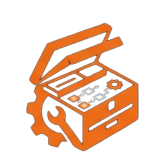
</p>

<h1 align="center">Boxly</h1>

<p align="center">
  <strong>Sistema de gestión de taller mecánico automotriz</strong><br />
  Todo el taller, de la recepción a la entrega: clientes, vehículos, órdenes de trabajo, repuestos, turnos, cobros y pagos online, con portal para el cliente.
</p>

<p align="center">
  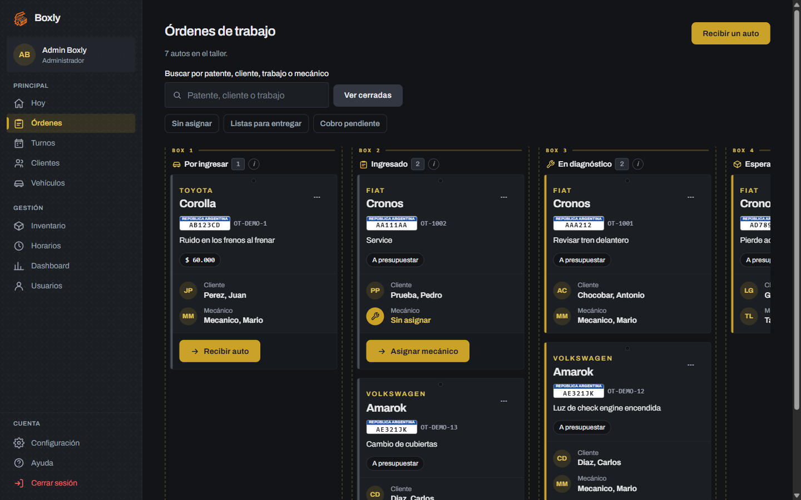
</p>

Repositorio: [github.com/Antony27c/Boxly](https://github.com/Antony27c/Boxly)

## Contenido

- [Funcionalidades](#funcionalidades)
- [Capturas](#capturas)
- [Stack](#stack)
- [Estructura del repositorio](#estructura-del-repositorio)
- [Puesta en marcha](#puesta-en-marcha)
- [Calidad: tests, lint y CI](#calidad-tests-lint-y-ci)
- [Seguridad](#seguridad)
- [Variables de entorno del backend](#variables-de-entorno-del-backend)
- [Integraciones](#integraciones)
- [API](#api)
- [Datos de demo](#datos-de-demo)
- [Despliegue](#despliegue)
- [Equipo](#equipo)

## Funcionalidades

- **Hoy:** la pantalla de inicio de cada rol con lo que hay que hacer en el día: turnos, autos listos para entregar, órdenes sin mecánico, cobros por aprobar y repuestos con stock bajo. Cada fila tiene su acción principal a un toque.
- **Órdenes de trabajo:** tablero por etapas (Pendiente → Ingresado → En diagnóstico → Esperando repuestos → Listo → Entregado, o Cancelado), donde cada columna es un box del taller. Cada orden lleva diagnóstico, repuestos, mano de obra, fotos por etapa e historial, y las cerradas ya no se pueden editar.
- **Ingreso rápido por patente:** "Recibir un auto" busca la patente, sugiere coincidencias y crea la orden en pocos pasos, o recibe el auto desde un turno.
- **Clientes y vehículos:** alta guiada de cliente y vehículo, ficha técnica, libreta de service con el historial de órdenes e invitación por correo al portal.
- **Cobro y pagos online:** el mecánico propone el monto, recepción lo aprueba y el cliente paga desde su portal con Mercado Pago (sandbox). El webhook firmado confirma el pago y hay protección contra el doble cobro.
- **Inventario:** el stock se muestra como una varilla de aceite con marcas MIN y MAX. Se descuenta solo al cargar repuestos en una orden y se devuelve al cancelar, siempre de forma atómica. Hay alertas de stock bajo e ingresos de mercadería.
- **Agenda y turnos:** turnos cada 2 horas, con mecánico opcional y sin superposición, más el calendario y los horarios de cada mecánico.
- **Dashboard:** estética de tablero de auto, con velocímetro de autos en el taller, display de 7 segmentos, combustible, luces testigo para las alertas y termómetro de carga. Muestra balance, facturación, ingresos, ticket promedio y equipo por período, y exporta a CSV.
- **Portal del cliente:** sus vehículos, el seguimiento de cada orden como una ruta con un autito que avanza hasta la bandera de llegada, la línea de tiempo con fotos y el pago online.
- **Roles:** Administrador, Recepción, Mecánico y Cliente. El mecánico solo ve los clientes, vehículos, turnos y órdenes vinculados a sus trabajos.
- **Interfaz:** tema claro, oscuro o automático, diseño responsive con barra inferior en celular, preferencias de accesibilidad (reducir movimiento y texto grande), una sección de ayuda con preguntas frecuentes y detalles de taller (patente Mercosur, ilustraciones y texturas) que acompañan al dato sin taparlo.

## Capturas

### Hoy y Dashboard

| Hoy (administrador) | Dashboard |
|---|---|
| 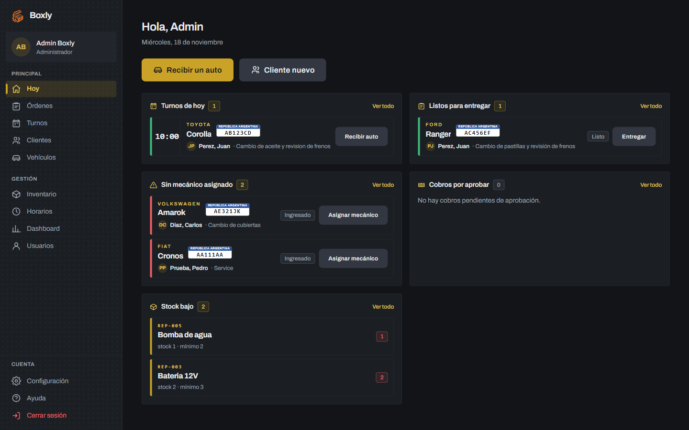 | 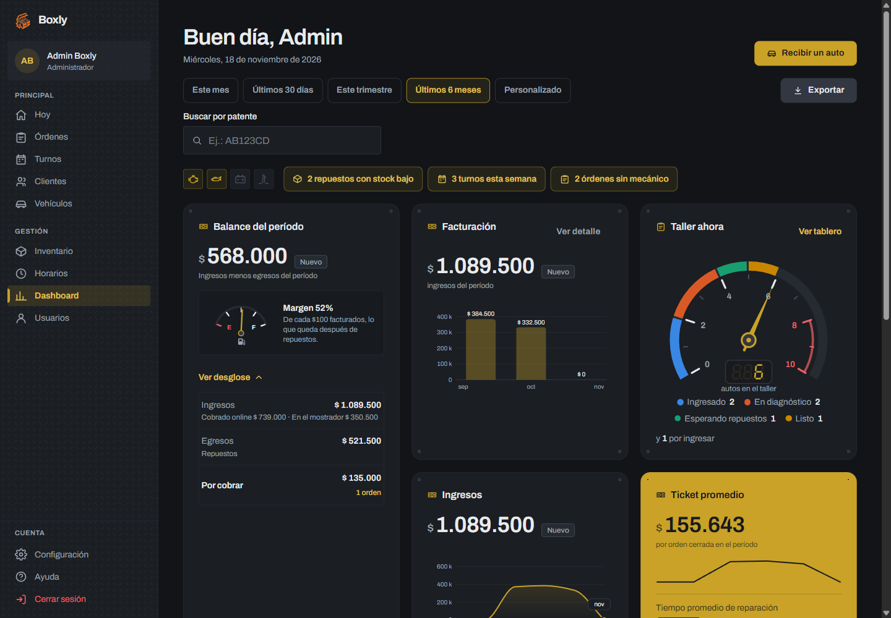 |

### Órdenes

| Detalle de una orden | Tablero en tema claro |
|---|---|
| 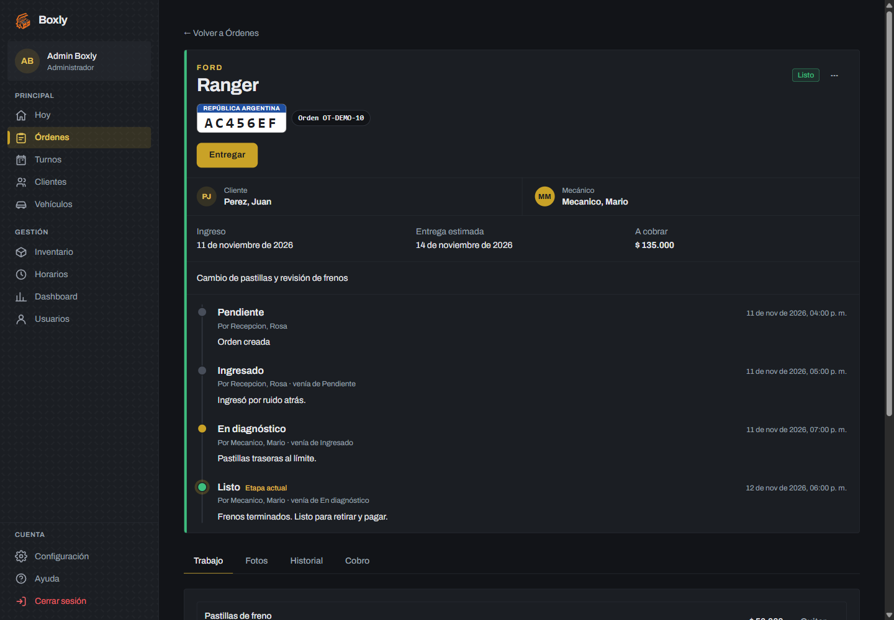 | 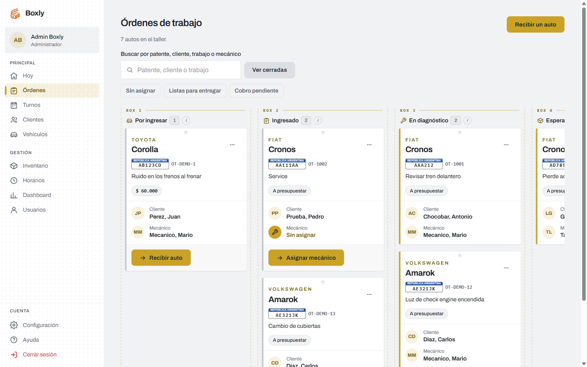 |

### Vehículos e inventario

| Vehículos | Inventario |
|---|---|
| 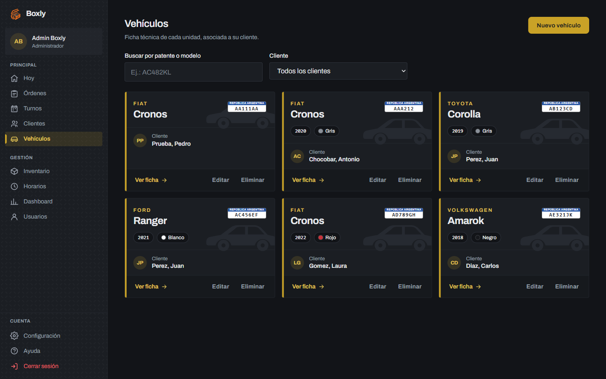 | 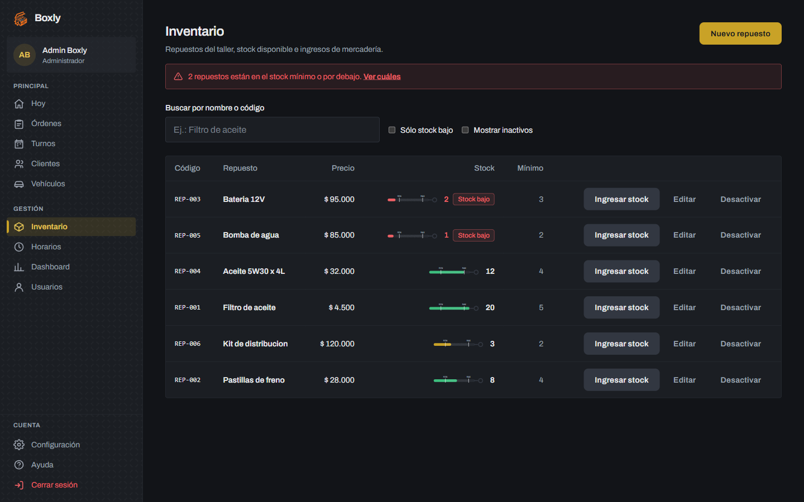 |

### Portal del cliente

| Mis vehículos y órdenes | Seguimiento de una orden |
|---|---|
| 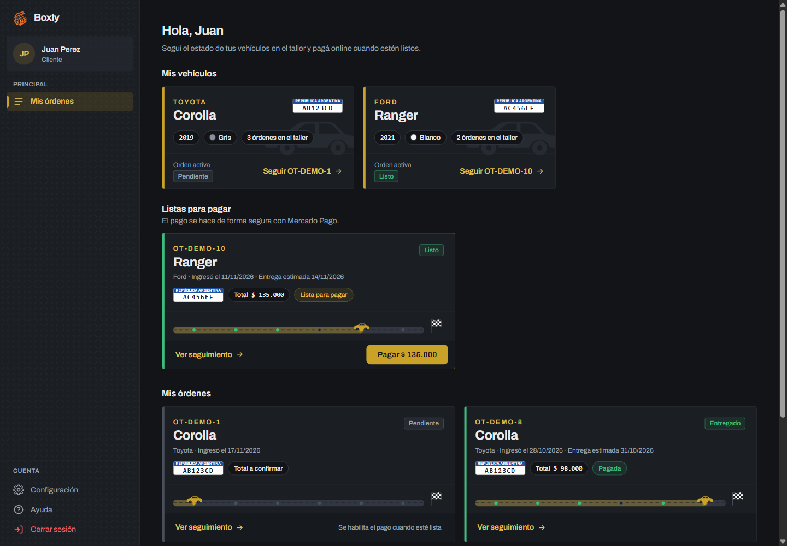 | 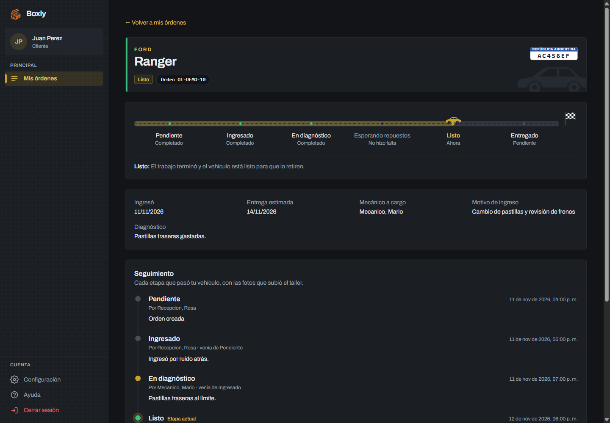 |

### Celular y acceso

| Hoy | Órdenes | Portal | Login |
|---|---|---|---|
| 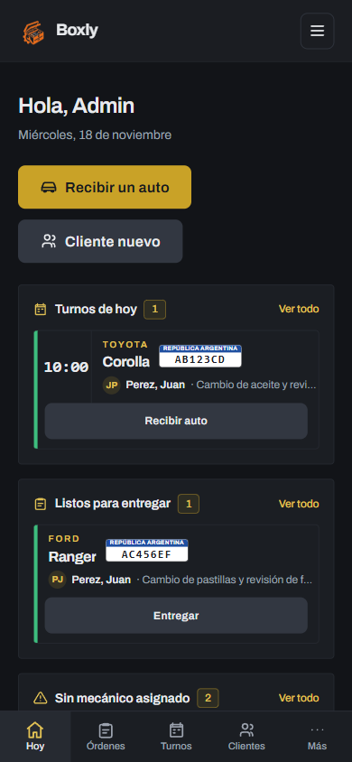 | 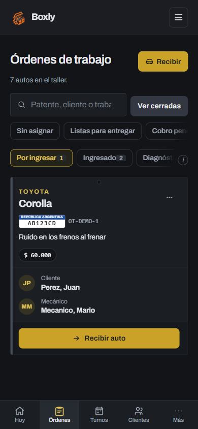 | 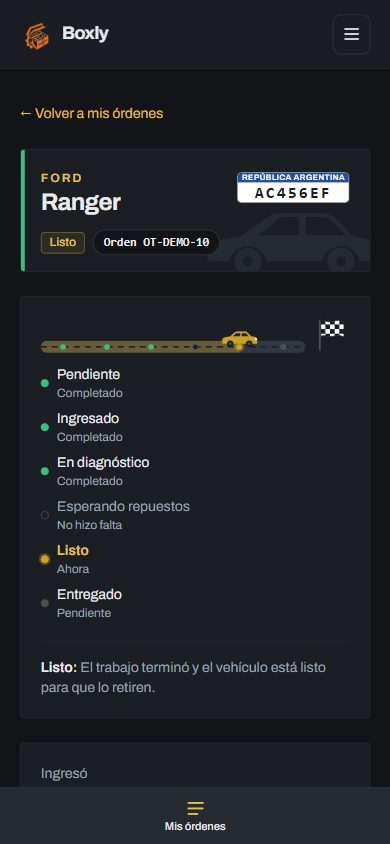 | 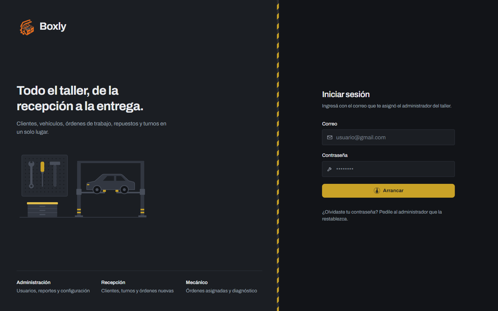 |

## Stack

| Capa | Tecnología |
|------|------------|
| Frontend | React 18 + Vite + Tailwind CSS (gráficos e ilustraciones en SVG propio, sin librerías extra) |
| Backend | Python 3.12 / FastAPI / SQLAlchemy / Pydantic / Alembic |
| Base de datos | PostgreSQL 16 |
| Autenticación | JWT (PyJWT) + bcrypt |
| Pagos | Mercado Pago (sandbox) |
| Email | Gmail SMTP |
| Tests | pytest (backend) · Vitest + Testing Library (frontend) |
| CI | GitHub Actions |
| Despliegue | VPS con Docker Compose y Caddy (HTTPS automático) |

## Estructura del repositorio

```
Boxly/
├── backend/               # API FastAPI: auth, usuarios, clientes, vehículos, turnos, órdenes,
│   ├── app/               #   repuestos, pagos, portal, catálogo, mecánicos y métricas
│   ├── alembic/           # Migraciones de la base
│   ├── scripts/           # create_admin, seed_demo y seed_catalogo
│   └── tests/             # Tests con pytest
├── frontend/              # Interfaz React + Vite
│   └── src/               # pages, components, services, hooks, context y test
├── docs/
│   ├── DER.md             # Modelo entidad-relación
│   ├── Contratos_API_Semana7.md
│   ├── DEPLOY.md          # Guía de despliegue en un VPS
│   └── capturas/          # Imágenes de este README
├── scripts/               # backup.sh y restore.sh de la base
├── docker-compose.yml     # db + api + web + caddy
├── Caddyfile
├── .env.prod.example
└── .github/workflows/ci.yml
```

## Puesta en marcha

Hace falta Python 3.12, Node 20 y PostgreSQL.

### Backend

Desde `backend/`:

```bash
python -m venv venv
venv\Scripts\activate          # Windows (en Linux/macOS: source venv/bin/activate)
pip install -r requirements.txt
pip install -r requirements-dev.txt   # solo para correr los tests (pytest, httpx, ruff)
copy .env.example .env                # Linux/macOS: cp .env.example .env
```

Ajustar `backend/.env` (ver [las variables](#variables-de-entorno-del-backend)). Crear la base `boxly` en PostgreSQL y luego:

```bash
alembic upgrade head             # crea las tablas
python -m scripts.create_admin   # admin inicial: pide la contraseña por terminal (o BOXLY_ADMIN_PASSWORD)
python -m scripts.seed_demo      # datos de demo (se puede correr varias veces, no duplica)
uvicorn app.main:app --reload
```

La API queda en `http://127.0.0.1:8000`. La documentación interactiva está en `/docs`, **solo cuando `ENVIRONMENT=dev`** (en producción no se expone).

Para cambios de modelo: `alembic revision --autogenerate -m "descripcion del cambio"` y luego `alembic upgrade head`.

### Frontend

Desde `frontend/`:

```bash
npm install
copy .env.example .env          # Linux/macOS: cp .env.example .env
npm run dev
```

`VITE_API_URL` tiene que apuntar al backend (`http://localhost:8000` por defecto). La app queda en `http://localhost:5173`.

**Probar desde el celular o desde otra PC de la red:** `npx vite --mode lan --host`. En ese modo el frontend llama a `/api` en su mismo origen y Vite lo reenvía al backend (`BOXLY_API_PROXY`, por defecto `http://localhost:8000`), así que alcanza con abrir `http://<ip-de-la-pc>:5173` desde el otro dispositivo.

Para entrar, usar los [usuarios de demo](#datos-de-demo) (contraseña `Demo1234`).

## Calidad: tests, lint y CI

| | Comando | Qué cubre |
|---|---|---|
| Backend | `python -m pytest -q` (desde `backend/`) | 394 tests: matriz de roles por router, máquina de estados de la orden, pagos (concurrencia, firma del webhook, reembolsos), integridad de datos, rendimiento de listados (N+1), seguridad de auth y config, y un flujo completo del taller por la API |
| Frontend | `npm test` (desde `frontend/`) | 317 tests de páginas y componentes con Vitest + Testing Library, incluidos los textos alternativos y `aria-label` de gráficos e ilustraciones |
| Lint | `npm run lint` · `ruff check .` | ESLint en cero en el frontend; ruff en el backend |

En cada push, **GitHub Actions** ([`ci.yml`](.github/workflows/ci.yml)) corre el backend sobre PostgreSQL 16 (migraciones con Alembic y pytest; ruff por ahora como aviso) y el frontend (lint, build y tests).

## Seguridad

- En `ENVIRONMENT=prod` la app no arranca con un `JWT_SECRET_KEY` débil o de ejemplo ni con `DEBUG=true`, y no expone `/docs` ni `/openapi.json`.
- Login sin enumeración de usuarios: los tiempos se igualan y el mensaje es siempre el mismo. Además tiene rate limit (`POST /auth/login`: 5 por minuto por IP).
- Cambiar la contraseña o desactivar un usuario invalida sus sesiones abiertas (`token_version`).
- Permisos por rol en cada endpoint, cubiertos por una matriz de tests.
- El webhook de Mercado Pago se valida con la firma `x-signature`, el pago se consulta a la API de MP sin confiar en el cuerpo, y un índice único evita dos pagos pendientes de la misma orden.
- Las imágenes subidas se re-codifican con Pillow. Los errores de base devuelven un `409` genérico sin mostrar SQL.
- Restricciones `CHECK`, índices únicos e índices en las claves foráneas aseguran la integridad de los datos.

## Variables de entorno del backend

Todas se definen en `backend/.env` (partir de `.env.example`). Las sensibles **nunca** se suben al repo.

### Entorno y seguridad

| Variable | Default | Descripción |
|----------|---------|-------------|
| `ENVIRONMENT` | `dev` | `dev` o `prod`. En `prod` la app no arranca sin `JWT_SECRET_KEY` real (≥ 32 caracteres, sin placeholders) y con `DEBUG=true`, y no expone `/docs` ni `/openapi.json`. |
| `DEBUG` | `false` | Modo debug. Habilita `POST /pagos/{id}/simular` (solo para el administrador) y permite crear pagos sin `MP_ACCESS_TOKEN`. Debe ser `false` en producción. |
| `RATE_LIMIT_ENABLED` | `true` | Rate limiting con slowapi. En `false` se desactiva (por ejemplo, para pruebas). Límites actuales: `POST /auth/login` 5/minuto y `POST /auth/activacion` 10/minuto por IP; al superarlos responde `429`. |
| `JWT_SECRET_KEY` | *(vacío)* | Secreto para firmar los JWT. Generar con `python -c "import secrets; print(secrets.token_urlsafe(48))"`. Obligatorio en producción; en dev, si queda vacío se usa uno inseguro de prueba (con warning en el log). |
| `JWT_ALGORITHM` | `HS256` | Algoritmo de firma del JWT. |
| `ACCESS_TOKEN_EXPIRE_MINUTES` | `60` | Duración del token de acceso. |
| `CORS_ORIGINS` | `http://localhost:5173,http://127.0.0.1:5173` | Orígenes permitidos, separados por coma. |

### Base de datos

| Variable | Default | Descripción |
|----------|---------|-------------|
| `DATABASE_URL` | — | Si está definida, tiene prioridad sobre `POSTGRES_*` (ej. `sqlite:///./boxly.db` para pruebas rápidas). |
| `POSTGRES_USER` | `postgres` | Usuario de PostgreSQL. |
| `POSTGRES_PASSWORD` | — | Contraseña de PostgreSQL. |
| `POSTGRES_HOST` | `localhost` | Host de PostgreSQL. |
| `POSTGRES_PORT` | `5432` | Puerto de PostgreSQL. |
| `POSTGRES_DB` | `boxly` | Nombre de la base. |

### Mercado Pago

| Variable | Default | Descripción |
|----------|---------|-------------|
| `MP_ACCESS_TOKEN` | — | Access Token de **prueba** de la cuenta de desarrollador de Mercado Pago. Sin token (y con `DEBUG=true`) los pagos se simulan en local. |
| `MP_WEBHOOK_SECRET` | — | Secreto para validar la firma `x-signature` de las notificaciones del webhook. Generar con `python -c "import secrets; print(secrets.token_urlsafe(48))"`. |
| `FRONTEND_URL` | `http://localhost:5173` | URL del frontend; Mercado Pago redirige ahí al terminar el pago. |
| `BACKEND_PUBLIC_URL` | — | URL pública **https** del backend para el webhook (en local, con ngrok). Vacía = sin notificaciones de MP. |

### Email (Gmail SMTP)

| Variable | Default | Descripción |
|----------|---------|-------------|
| `SMTP_HOST` | `smtp.gmail.com` | Servidor SMTP. |
| `SMTP_PORT` | `587` | Puerto SMTP (STARTTLS). |
| `SMTP_USER` | — | Cuenta de Gmail que envía los correos. |
| `SMTP_PASSWORD` | — | **App Password** de Google (no la contraseña de la cuenta). Se genera en la cuenta de Google → Seguridad → Verificación en 2 pasos → Contraseñas de aplicaciones. |
| `SMTP_FROM_NAME` | `Boxly Taller Mecánico` | Nombre del remitente. |
| `SMTP_FROM_EMAIL` | — | Dirección del remitente; si está vacía usa `SMTP_USER`. |
| `SMTP_TLS` | `true` | Conexión cifrada. |

Se usan para: invitación al portal del cliente, aviso de activación de cuenta, notificación de cambio de estado de la orden y aviso de cobro.

### Solo para demo / scripts

| Variable | Default | Descripción |
|----------|---------|-------------|
| `CLIENTE_PASSWORD_DNI` | `false` | **SOLO DEMO — insegura.** En `true`, un cliente sin cuenta puede entrar con su email y su DNI/CUIT como contraseña (la cuenta se crea en el primer login). Dejar en `false` fuera de una demo. |
| `BOXLY_ADMIN_EMAIL` | `admin@boxly.com` | Email del admin inicial (`scripts/create_admin.py`). |
| `BOXLY_ADMIN_PASSWORD` | — | Contraseña del admin inicial. Si falta, el script la pide por terminal. |
| `BOXLY_ADMIN_NOMBRE` / `BOXLY_ADMIN_APELLIDO` | `Admin` / `Boxly` | Nombre del admin inicial. |

## Integraciones

### Mercado Pago (sandbox)

1. Crear una aplicación en [Mercado Pago Developers](https://www.mercadopago.com.ar/developers) y copiar el **Access Token de prueba** en `MP_ACCESS_TOKEN`.
2. El cliente paga desde el portal (`/portal/pago`). El backend crea la preferencia con `costo_final` de la orden y Mercado Pago vuelve a `{FRONTEND_URL}/portal/pago/{aprobado|rechazado|pendiente}?pago_id=N`.
3. **Webhook:** Mercado Pago avisa a `{BACKEND_PUBLIC_URL}/api/v1/pagos/webhook`. En local hace falta exponer el backend con ngrok (`ngrok http 8000`) y poner la URL https en `BACKEND_PUBLIC_URL`. El backend consulta el pago a la API de MP (no confía en el cuerpo), valida la firma con `MP_WEBHOOK_SECRET` y actualiza el `Pago`.
4. **Sin token y con `DEBUG=true`** (solo dev): `url_pago` apunta a una pantalla interna y el administrador puede usar `POST /api/v1/pagos/{id}/simular` para aprobar o rechazar el pago a mano. En producción ese endpoint responde `404`.
5. Al volver del checkout, el frontend confirma el resultado con `POST /api/v1/pagos/{id}/confirmar`.

### Email con Gmail

Los correos salen por SMTP de Gmail. Gmail no acepta la contraseña normal: hay que generar una **App Password** (requiere verificación en 2 pasos) y ponerla en `SMTP_PASSWORD`. Si falta configuración, los avisos quedan registrados como `omitido`/`fallido` en la tabla `notificaciones` sin romper la operación.

## API

Base: `http://localhost:8000/api/v1`. Autenticación: `Authorization: Bearer <token>` en todo salvo `POST /auth/login`, `GET|POST /auth/activacion` y `POST /pagos/webhook`.

Contratos y ejemplos JSON: [`docs/Contratos_API_Semana7.md`](docs/Contratos_API_Semana7.md). Swagger interactivo en `http://127.0.0.1:8000/docs` (**solo en dev**). Rate limit activo por defecto (`RATE_LIMIT_ENABLED`); al superarlo responde `429`.

Resumen de routers (roles: **A**dministrador, **R**ecepción, **M**ecánico, **C**liente):

| Módulo | Qué expone | Quién accede |
|--------|-----------|--------------|
| `auth` | `POST /login` (5 req/min), `GET /me`, `GET /activacion` y `POST /activacion` (10 req/min, enlace del correo) | Público / autenticado |
| `users` | CRUD de usuarios y `GET /users/mecanicos` (para asignar) | A (CRUD) · A+R (mecánicos) |
| `clientes` | CRUD de clientes, `?q=` y `POST /clientes/{id}/invitacion` (envía/reenvía el correo de activación del portal) | Lectura: personal (el mecánico solo los de sus órdenes) · Escritura y aviso: A+R |
| `vehiculos` | CRUD y `GET /vehiculos/{id}/ordenes` (historial) | Lectura: personal (el mecánico solo los de sus órdenes) · Escritura: A+R |
| `turnos` | CRUD, `PUT /{id}/estado`, grilla cada 2 h y `mecanico_id` opcional | Lectura: personal (el mecánico solo los de sus órdenes) · Escritura: A+R |
| `ordenes` | CRUD, `GET /estados` (cualquier autenticado), `PATCH` (cambio de estado con comentario), detalles, imágenes, historial, cobro y notificaciones | Lectura y cambio de estado: personal (mecánico solo las suyas) · Crear/eliminar: A+R |
| `repuestos` | CRUD, `GET /stock-bajo` y `POST /{id}/ingresos` (suma stock) | Lectura: personal · Escritura: A+R |
| `catalogo` | `GET /catalogo/marcas` y `GET /catalogo/modelos` (con `?q=`) | Cualquier usuario autenticado |
| `metricas` | `GET /mecanicos`, `GET /finanzas`, `GET /mejor-mecanico` | A |
| `mecanicos` | Horarios del mecánico (CRUD) y `GET /{id}/calendario` | Lectura: personal (el mecánico solo el suyo) · Escritura de horarios: A |
| `pagos` | `POST /webhook` (MP), `POST /ordenes/{id}`, `GET /{id}`, `POST /{id}/confirmar`, `POST /{id}/simular` (solo dev) | Webhook: público · Resto: A+C (cliente solo los suyos) |
| `portal` | `GET /mis-vehiculos`, `GET /mis-ordenes`, `GET /mis-ordenes/{id}` | C |

## Datos de demo

`python -m scripts.seed_demo` carga el catálogo de marcas y modelos, 2 clientes con cuenta, vehículos, repuestos (2 con stock bajo), turnos y órdenes con historial, repuestos, mano de obra, pagos y notificaciones. Las fechas son relativas al día en que se corre.

| Usuario | Rol | Para probar |
|---|---|---|
| `superadmin@boxly.com` | Superadmin | Panel de control: cuentas, auditoría y respaldo |
| `admin@boxly.com` | Administrador | Todo el sistema |
| `recepcion@boxly.com` | Recepción | Clientes, vehículos, turnos y órdenes |
| `mecanico@boxly.com` | Mecánico (Mario) | Solo sus órdenes y vehículos |
| `mecanico2@boxly.com` | Mecánico (Lucía) | Solo sus órdenes y vehículos |
| `cliente@boxly.com` | Cliente (Juan Perez) | Portal: tiene la orden `OT-DEMO-10` lista para pagar |
| `cliente2@boxly.com` | Cliente (Laura Gomez) | Portal: orden con pago rechazado y reintentado, y una cancelada |

Contraseña de todos: `Demo1234`.

Otros scripts: `python -m scripts.create_admin` (admin inicial) y `python -m scripts.seed_catalogo` (solo marcas y modelos). El único seed de datos es `python -m scripts.seed_demo`.

## Despliegue

El deploy es un **VPS con Docker Compose**: PostgreSQL, backend, frontend y Caddy con HTTPS automático, más los scripts de backup y restore de la base. La guía paso a paso está en [`docs/DEPLOY.md`](docs/DEPLOY.md) y las variables de producción, en [`.env.prod.example`](.env.prod.example).

El backend expone `GET /health` (sin autenticación y fuera del schema de la API). Devuelve `200` con `{estado, db, version}` si la base responde y `503` con `{estado: "degradado", db: "error"}` si falla. Docker y Caddy lo usan para el healthcheck.

## Equipo

| Nombre | Rol |
|--------|-----|
| Antony Chocobar | Líder de proyecto / Scrum Master: autenticación, roles y DER |
| Julieta Andrea Cardozo | Frontend: clientes, vehículos, agenda y turnos |
| Gabriel Ulunqui | Backend: órdenes de trabajo y turnos |
| Pablo Romano | Backend y base de datos: PostgreSQL e inventario |

Trabajamos con Scrum adaptado, en sprints de 2 semanas, con un tablero en Trello (Por hacer / En progreso / Hecho).
