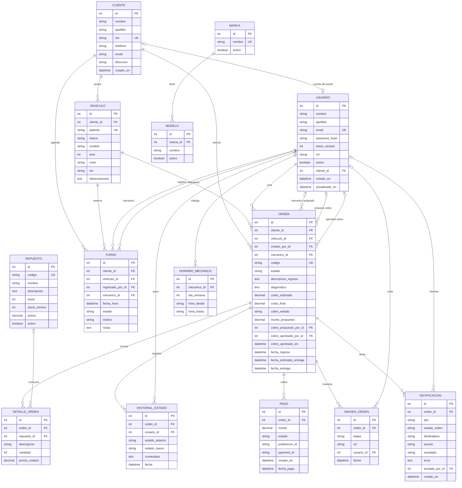

# Modelo Entidad-Relación (DER) — Boxly

**Proyecto:** Boxly – Sistema de Gestión de Taller Mecánico Automotriz  
**Versión:** 2.0 · **Fecha:** 2026-11-17  
**Fuente de verdad:** `backend/app/models/*.py` (SQLAlchemy). Este documento se regeneró a partir del código: si difiere de los modelos, mandan los modelos.

---

## 1. Alcance del modelo

El DER describe el dominio completo del taller y **ya está materializado en código**: las 14 entidades de este documento existen como modelos SQLAlchemy y tablas creadas por las migraciones de Alembic.

### Roles de sistema (Usuario.rol)

| Rol | Descripción |
|-----|-------------|
| `administrador` | Gestión de usuarios, configuración, métricas y visión completa |
| `recepcion` | Clientes, vehículos, turnos, órdenes y cobros de mostrador |
| `mecanico` | Solo las órdenes, vehículos, clientes y turnos vinculados a sus trabajos |
| `cliente` | Portal propio: sus vehículos, órdenes y pagos (vinculado por `usuarios.cliente_id`) |

`ROLES_PERSONAL` = administrador + recepcion + mecanico: son los roles con acceso a la API interna. El rol `cliente` solo entra por `/portal`, `/mis-*` y `/pagos`.

---

## 2. Diagrama entidad-relación

---

## 3. Entidades y atributos

Convenciones: `NN` = NOT NULL, `PK` = clave primaria, `FK` = clave foránea, `UK` = única. `usuarios`, `clientes` y `turnos.fecha_hora` usan `TIMESTAMPTZ`; el resto de los `DateTime` del modelo (`ordenes`, `historial_estado`, `pagos`, `imagenes_orden`, `notificaciones`) no guardan zona — el contrato de API las emite sin zona salvo turnos.

### 3.1 Usuario (`usuarios`)

Personal interno del taller y clientes con acceso al portal.

| Columna | Tipo | Nulabilidad | Restricciones |
|---------|------|-------------|---------------|
| id | INTEGER | NN | PK, autoincremental |
| nombre | VARCHAR(80) | NN | |
| apellido | VARCHAR(80) | NN | |
| email | VARCHAR(120) | NN | UNIQUE, índice |
| password_hash | VARCHAR(255) | NN | bcrypt; nunca texto plano |
| token_version | INTEGER | NN | DEFAULT 0. Se copia en el claim `tv` del JWT: al cambiar la contraseña sube y los tokens viejos quedan inválidos |
| rol | VARCHAR (enum `rol_usuario`) | NN | `administrador` \| `recepcion` \| `mecanico` \| `cliente`. DEFAULT `recepcion` |
| activo | BOOLEAN | NN | DEFAULT TRUE. FALSE = deshabilitado (soft delete) |
| cliente_id | INTEGER | NULL | FK → clientes.id, UNIQUE: a lo sumo un usuario por cliente. Obligatorio si `rol = cliente`, nulo para el personal |
| creado_en | TIMESTAMPTZ | NN | DEFAULT now() |
| actualizado_en | TIMESTAMPTZ | NULL | se actualiza solo (onupdate) |

### 3.2 Cliente (`clientes`)

Dueño de uno o más vehículos. Puede tener una cuenta de portal (ver `usuarios.cliente_id`).

| Columna | Tipo | Nulabilidad | Restricciones |
|---------|------|-------------|---------------|
| id | INTEGER | NN | PK |
| nombre | VARCHAR(80) | NN | |
| apellido | VARCHAR(80) | NN | |
| dni | VARCHAR(20) | NN | UNIQUE, índice (DNI o CUIT) |
| telefono | VARCHAR(30) | NULL | |
| email | VARCHAR(120) | NULL | Si tiene email, se lo puede invitar al portal |
| direccion | VARCHAR(200) | NULL | |
| creado_en | TIMESTAMPTZ | NN | DEFAULT now() |

### 3.3 Vehículo (`vehiculos`)

| Columna | Tipo | Nulabilidad | Restricciones |
|---------|------|-------------|---------------|
| id | INTEGER | NN | PK |
| cliente_id | INTEGER | NN | FK → clientes.id |
| patente | VARCHAR(15) | NN | UNIQUE, índice (se normaliza a mayúsculas sin espacios) |
| marca | VARCHAR(60) | NN | Texto libre (el catálogo solo sugiere) |
| modelo | VARCHAR(60) | NN | Texto libre |
| anio | INTEGER | NULL | |
| color | VARCHAR(40) | NULL | |
| vin | VARCHAR(50) | NULL | |
| observaciones | TEXT | NULL | |

### 3.4 Orden de trabajo (`ordenes`)

Registro central de una reparación. Tiene **cuatro** relaciones hacia `usuarios`: quién la creó, qué mecánico la tiene asignada y quién propuso/aprobó el cobro.

Estados: `pendiente` → `ingresado` → `en_diagnostico` → `esperando_repuestos` → `listo` → `entregado`, más `cancelado`. El cambio de estado exige comentario (va al historial) y dispara un aviso por email al cliente.

| Columna | Tipo | Nulabilidad | Restricciones |
|---------|------|-------------|---------------|
| id | INTEGER | NN | PK |
| cliente_id | INTEGER | NN | FK → clientes.id |
| vehiculo_id | INTEGER | NN | FK → vehiculos.id |
| creado_por_id | INTEGER | NN | FK → usuarios.id (recepción/admin) |
| mecanico_id | INTEGER | NULL | FK → usuarios.id (mecánico asignado) |
| codigo | VARCHAR(30) | NN | UNIQUE, índice (`OT-XXXX`) |
| estado | VARCHAR(30) | NN | DEFAULT `pendiente`. CHECK `ck_ordenes_estado_valido`: solo los 7 estados del flujo |
| descripcion_ingreso | TEXT | NN | Motivo de ingreso declarado por el cliente |
| diagnostico | TEXT | NULL | Hallazgos del mecánico |
| costo_estimado | NUMERIC(12,2) | NULL | Presupuesto estimado |
| costo_final | NUMERIC(12,2) | NULL | Monto final aprobado en el cobro |
| cobro_estado | VARCHAR(20) | NULL | `pendiente` \| `aprobado` (propuesta del mecánico vs. cobro cerrado) |
| monto_propuesto | NUMERIC(12,2) | NULL | Monto que propuso el mecánico |
| cobro_propuesto_por_id | INTEGER | NULL | FK → usuarios.id |
| cobro_aprobado_por_id | INTEGER | NULL | FK → usuarios.id |
| cobro_aprobado_en | DATETIME | NULL | Cuándo se aprobó el cobro |
| fecha_ingreso | DATETIME | NN | DEFAULT now() |
| fecha_estimada_entrega | DATETIME | NULL | |
| fecha_entrega | DATETIME | NULL | Se completa al pasar a `entregado` |

### 3.5 Historial de estado (`historial_estado`)

Auditoría de cada cambio de estado de una orden (y del comentario asociado).

| Columna | Tipo | Nulabilidad | Restricciones |
|---------|------|-------------|---------------|
| id | INTEGER | NN | PK |
| orden_id | INTEGER | NN | FK → ordenes.id |
| usuario_id | INTEGER | NN | FK → usuarios.id (quién hizo el cambio) |
| estado_anterior | VARCHAR(30) | NULL | NULL en el alta de la orden |
| estado_nuevo | VARCHAR(30) | NN | |
| comentario | TEXT | NULL | Obligatorio al cambiar de estado (API) |
| fecha | DATETIME | NN | DEFAULT now() |

### 3.6 Detalle de orden (`detalles_orden`)

Líneas de la orden: repuestos usados (`repuesto_id` no nulo, descuentan stock) o mano de obra / ítems libres.

| Columna | Tipo | Nulabilidad | Restricciones |
|---------|------|-------------|---------------|
| id | INTEGER | NN | PK |
| orden_id | INTEGER | NN | FK → ordenes.id |
| repuesto_id | INTEGER | NULL | FK → repuestos.id (NULL = ítem sin repuesto) |
| descripcion | VARCHAR(200) | NN | |
| cantidad | INTEGER | NN | DEFAULT 1, > 0 |
| precio_unitario | NUMERIC(12,2) | NN | |

### 3.7 Repuesto (`repuestos`)

Inventario de piezas. `stock_bajo` se calcula (`stock <= stock_minimo`) y no es columna.

| Columna | Tipo | Nulabilidad | Restricciones |
|---------|------|-------------|---------------|
| id | INTEGER | NN | PK |
| codigo | VARCHAR(40) | NN | UNIQUE, índice (se normaliza a mayúsculas) |
| nombre | VARCHAR(120) | NN | |
| descripcion | TEXT | NULL | |
| stock | INTEGER | NN | DEFAULT 0. Descuenta al cargar en la orden, devuelve al cancelar/eliminar; `CHECK (stock >= 0)` |
| stock_minimo | INTEGER | NN | DEFAULT 0 |
| precio | NUMERIC(12,2) | NN | |
| activo | BOOLEAN | NN | DEFAULT TRUE |

### 3.8 Turno (`turnos`)

Cita agendada para traer el vehículo. La API solo acepta horarios en punto de la grilla cada 2 horas: **08:00, 10:00, 12:00, 14:00 y 16:00** (422 si no), y rechaza superposición de horario.

| Columna | Tipo | Nulabilidad | Restricciones |
|---------|------|-------------|---------------|
| id | INTEGER | NN | PK |
| cliente_id | INTEGER | NN | FK → clientes.id |
| vehiculo_id | INTEGER | NULL | FK → vehiculos.id |
| registrado_por_id | INTEGER | NN | FK → usuarios.id (quién lo cargó) |
| mecanico_id | INTEGER | NULL | FK → usuarios.id (mecánico que atiende) |
| fecha_hora | TIMESTAMPTZ | NN | |
| estado | VARCHAR(20) | NN | DEFAULT `pendiente`. CHECK `ck_turnos_estado_valido`: `pendiente` \| `confirmado` \| `en_taller` \| `completado` \| `cancelado` \| `asistio`. Índice único parcial `uq_turnos_mecanico_fecha_hora` en (`fecha_hora`, `mecanico_id`) WHERE `estado <> 'cancelado' AND mecanico_id IS NOT NULL` |
| motivo | VARCHAR(200) | NULL | |
| notas | TEXT | NULL | |

### 3.9 Horario de mecánico (`horarios_mecanico`)

Franjas semanales en que atiende cada mecánico (base del calendario).

| Columna | Tipo | Nulabilidad | Restricciones |
|---------|------|-------------|---------------|
| id | INTEGER | NN | PK |
| mecanico_id | INTEGER | NN | FK → usuarios.id, índice |
| dia_semana | INTEGER | NN | 0 = lunes … 6 = domingo |
| hora_desde | VARCHAR(5) | NN | `HH:MM` |
| hora_hasta | VARCHAR(5) | NN | `HH:MM`, > `hora_desde`; no puede superponerse con otra franja del mismo día |

### 3.10 Imagen de orden (`imagenes_orden`)

Foto adjunta a una orden, asociada a la etapa en que se sacó. El archivo vive en `backend/uploads/ordenes/{orden_id}/` y la API devuelve la ruta relativa.

| Columna | Tipo | Nulabilidad | Restricciones |
|---------|------|-------------|---------------|
| id | INTEGER | NN | PK |
| orden_id | INTEGER | NN | FK → ordenes.id, índice |
| etapa | VARCHAR(30) | NULL | Código de estado al momento de subirla |
| url | VARCHAR(500) | NN | Ruta relativa `/uploads/...` (nombre UUID) |
| usuario_id | INTEGER | NULL | FK → usuarios.id (quién la subió) |
| fecha | DATETIME | NN | DEFAULT now() |

### 3.11 Marca (`marcas`)

Catálogo de marcas para sugerir en el alta de vehículos.

| Columna | Tipo | Nulabilidad | Restricciones |
|---------|------|-------------|---------------|
| id | INTEGER | NN | PK |
| nombre | VARCHAR(100) | NN | UNIQUE |
| activo | BOOLEAN | NN | DEFAULT TRUE |

### 3.12 Modelo (`modelos`)

Catálogo de modelos por marca.

| Columna | Tipo | Nulabilidad | Restricciones |
|---------|------|-------------|---------------|
| id | INTEGER | NN | PK |
| marca_id | INTEGER | NN | FK → marcas.id, índice |
| nombre | VARCHAR(100) | NN | UNIQUE junto con `marca_id` (`uq_modelos_marca_nombre`) |
| activo | BOOLEAN | NN | DEFAULT TRUE |

### 3.13 Pago (`pagos`)

Pago online de una orden (Mercado Pago). `estado`: `pendiente` \| `aprobado` \| `rechazado` \| `reembolsado` (CHECK `ck_pagos_estado_valido`). Índice único parcial `uq_pagos_payment_id` sobre `payment_id` cuando no es NULL. Una orden está `pagada` cuando tiene al menos un pago `aprobado` (propiedad calculada).

| Columna | Tipo | Nulabilidad | Restricciones |
|---------|------|-------------|---------------|
| id | INTEGER | NN | PK |
| orden_id | INTEGER | NN | FK → ordenes.id, índice |
| monto | NUMERIC(12,2) | NN | Copia de `costo_final` al crear el pago |
| estado | VARCHAR(20) | NN | DEFAULT `pendiente`. CHECK `ck_pagos_estado_valido`: `pendiente` \| `aprobado` \| `rechazado` \| `reembolsado` |
| preference_id | VARCHAR(100) | NULL | ID de la preferencia de MP |
| payment_id | VARCHAR(50) | NULL | ID del pago en MP (cuando se conoce) |
| creado_en | DATETIME | NN | DEFAULT now() |
| fecha_pago | DATETIME | NULL | Se completa al aprobarse |

### 3.14 Notificación (`notificaciones`)

Comprobante de cada aviso por email que se intentó mandar al cliente (cambio de estado o cobro). `resultado`: `enviado` \| `fallido` \| `omitido`. `enviado_por_id` en NULL = aviso automático; con valor = reenvío manual del administrador.

| Columna | Tipo | Nulabilidad | Restricciones |
|---------|------|-------------|---------------|
| id | INTEGER | NN | PK |
| orden_id | INTEGER | NN | FK → ordenes.id, índice |
| tipo | VARCHAR(30) | NN | DEFAULT `cambio_estado` (`cambio_estado` \| `cobro`) |
| estado_orden | VARCHAR(30) | NN | Estado de la orden al momento del aviso |
| destinatario | VARCHAR(120) | NN | Email del cliente |
| asunto | VARCHAR(200) | NN | |
| resultado | VARCHAR(20) | NN | `enviado` \| `fallido` \| `omitido` |
| error | TEXT | NULL | Detalle del fallo de SMTP |
| enviado_por_id | INTEGER | NULL | FK → usuarios.id (NULL = automático) |
| creado_en | DATETIME | NN | DEFAULT now() |

---

## 4. Cardinalidades y reglas de negocio

| Relación | Cardinalidad | Regla de negocio |
|----------|--------------|------------------|
| Cliente – Vehículo | 1:N | Un cliente puede tener varios vehículos; cada vehículo pertenece a un cliente |
| Cliente – Orden | 1:N | Un cliente puede tener muchas órdenes |
| Cliente – Usuario | 1:0..1 | `usuarios.cliente_id` es UNIQUE: un cliente tiene a lo sumo una cuenta de portal |
| Vehículo – Orden | 1:N | Un vehículo acumula historial de órdenes |
| Usuario – Orden | 1:N ×4 | Un usuario puede crear órdenes, estar asignado como mecánico y proponer/aprobar cobros (cuatro FK distintas a `usuarios`) |
| Orden – DetalleOrden | 1:N | Líneas de repuestos y mano de obra |
| Repuesto – DetalleOrden | 1:N | Un repuesto puede figurar en varios detalles; `repuesto_id` NULL = ítem libre |
| Orden – HistorialEstado | 1:N | Trazabilidad de cambios de estado con comentario |
| Orden – Pago | 1:N | Varios intentos de pago; la orden está paga con uno `aprobado` |
| Orden – ImagenOrden | 1:N | Fotos por etapa del trabajo |
| Orden – Notificacion | 1:N | Comprobantes de los avisos por email |
| Cliente / Vehículo / Usuario – Turno | N:1 | Agenda de citas; el turno puede tener mecánico asignado |
| Usuario – HorarioMecanico | 1:N | Franjas semanales del mecánico |
| Marca – Modelo | 1:N | Modelos agrupados por marca, único `(marca_id, nombre)` |

---

## 5. Notas técnicas

- Motor: **PostgreSQL**. ORM: **SQLAlchemy 2.x** + migraciones **Alembic** (`alembic upgrade head`).
- Contraseñas: solo se persiste `password_hash` (bcrypt); nunca texto plano.
- Soft-delete: `usuarios.activo` y `repuestos.activo`; el resto usa borrado lógico según el módulo.
- El mecánico está filtrado en la API (`filtro_mecanico`): solo ve órdenes, vehículos, clientes y turnos vinculados a sus trabajos. El cliente del portal está filtrado por `usuarios.cliente_id`; un recurso ajeno responde 404.
- Índices: `usuarios.email`, `usuarios.cliente_id` (único), `clientes.dni`, `vehiculos.cliente_id`/`patente`, `ordenes.codigo`/`cliente_id`/`vehiculo_id`/`mecanico_id`/`estado`/`fecha_ingreso`, `historial_estado.orden_id`, `detalles_orden.orden_id`, `repuestos.codigo`, `turnos.cliente_id`/`mecanico_id`/`fecha_hora` (+ único parcial `uq_turnos_mecanico_fecha_hora`), `horarios_mecanico.mecanico_id`, `imagenes_orden.orden_id`, `modelos.marca_id`, `pagos.orden_id` (+ único parcial `uq_pagos_payment_id`), `notificaciones.orden_id`.
- CHECKs: `ordenes.estado` (7 estados del flujo), `turnos.estado` (6 estados), `pagos.estado` (4 estados), `repuestos.stock >= 0`.

---

## 6. Historia del documento

### v1.0 — 09/2026 (Sprint 1, tarea BD-01)

DER de diseño escrito antes de implementar: solo existía `Usuario`; el resto de las entidades estaba planificado por sprint. Queda como registro histórico del diseño original.

### v2.0 — 2026-11-17 (Fase 7, documentación)

Reescrito desde `backend/app/models/*.py`. Se agregaron las entidades implementadas desde entonces: `Pago`, `ImagenOrden`, `HorarioMecanico`, `Notificacion`, `Marca`, `Modelo`; el rol `cliente`; `usuarios.cliente_id`; los campos de cobro de `ordenes`; `token_version` de `usuarios`; y los estados reales de turno y pago.
